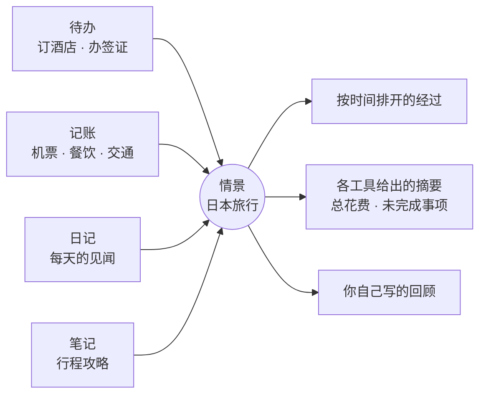

# Synap

按类型记录，按情景回看。

笔记会被拿去做完全不同的事：随手记、待办、AI 知识库、个人记录。这些事不该共用同一种组织结构。旧 Synap 用 DAG 去装全部，这条路不再走。

> [!NOTE]
> Synap 仍处于原型实验阶段。本仓库目前只公开设计文档，下文描述的是设计目标，不是已经提供的功能。

## 为什么做 Synap

一个人的记录通常散落在好几个 App 里：待办、记账、日记、读书笔记各用一个。每个 App 都好用，但数据彼此隔开。想回顾一次旅行，就得在几个 App 之间来回翻找。

Notion、Tana、Anytype 这类工具把数据放到了一起，但结构要用户自己搭：建库、配关系、写查询。

Synap 的出发点是：人记录时按类型来记，一笔账、一条待办、一篇日记；回看时却按情景来看，这次旅行、这个项目、这学期。专门的 App 只照顾了前一半，Synap 想把两半都做好，并且不需要用户自己搭建任何结构。

## 设计目标

### 专注的工具

待办、记账、日记各自是完整、好用的工具，有自己的页面和交互。Synap 不会为了"打通"而把不相关的数据混进同一个列表。

### 共用的入口

几样东西由所有工具共用：

- **一个输入框**：输入"午饭 35，和小王"，记账工具会认出这是一笔支出，不用先想该打开哪个 App。
- **一份待处理清单**：记账里待核实的账目、学习里待复习的内容、读书里待整理的摘录，会汇总到同一个地方，无需配置。
- **一个搜索框和完整的历史**：所有记录都能搜到，能看到它被哪些内容引用，也能回到任意一个历史版本。

### 情景

一次旅行、一个项目、一门课，往往同时包含多种记录。Synap 把它们归到同一个情景里：

- 进入某个情景后，这段时间里新记下的内容会自动归入其中。
- 情景页是一份可以阅读的记录：按时间顺序排列的经过，加上各个工具提供的摘要。它不是一块堆满数字的看板。
- 做过的情景可以拿来当下一次的起点，比如"像上次旅行那样准备"。

### 为小需求做小工具

常见的 App 只覆盖最普遍的需求。记吃药、记健身组数、管理收藏，这类小需求很少有趁手的工具。

Synap 计划支持让 AI 按你的描述生成这样的小工具。生成出来的工具和内置工具一样，能同步、搜索，也能出现在待处理清单和情景里。

### 与 AI 协作

Synap 不内置聊天窗口，而是通过标准接口连接你自己选择的 AI。AI 读到的是带结构的记录，而不是一堆零散的文本。一个情景就是一份现成的上下文；你也可以只授权 AI 读取某个情景，不开放整个库。

## 与现有工具的区别

| | 结构由谁搭建 | 数据是否在一处 | 使用前的配置 |
| --- | --- | --- | --- |
| 专门的 App | 开发者 | 否 | 几乎不需要 |
| Notion / Tana / Anytype | 用户 | 是 | 较多 |
| Synap | 工具作者或 AI | 是 | 选一套预设即可 |

## 数据由你掌握

- 数据保存在本地并加密。
- 同步方式由你选择：局域网、自建服务器或对象存储。
- 工具的定义和数据存放在一起。某个工具不再维护，数据也依然可读。

## 状态

Synap 是 [旧 Synap](https://github.com/VilinkoStudio/Synap) 之后的一次重新设计。旧版以碎片记录为核心，在扩展到待办、知识库等用途时遇到结构上的限制，所以从更底层重新开始。

目前已经完成底层与产品形态的设计，原型正在本地实验。第一个版本要验证两件事：情景能不能让人留下来，小工具能不能让人愿意来用。

- [x] 底层与产品形态设计
- [ ] 存储、同步与查询的原型
- [ ] 桌面与手机客户端
- [ ] 首批工具：随手记、待办，以及记账或读书之一
- [ ] 统一输入、待处理、情景
- [ ] 通过 AI 生成小工具

## 设计文档

架构与实现细节见 [`docs/`](docs/)，按编号顺序阅读。原型阶段以文档为规格。

| 文档 | 内容 |
| --- | --- |
| [000](docs/000-from-synap.md) | 与旧 Synap 的关系 |
| [001](docs/001-philosophy.md) | 设计理念与术语 |
| [002](docs/002-architecture.md) | 整体架构 |
| [003](docs/003-product-shape.md) | 产品形态 |
| [004](docs/004-synap-core.md) – [008](docs/008-synap-future.md) | 各模块规格 |

## 参与

现阶段最需要的是对设计的反馈：你会用它记什么，你想到的情景是什么，文档中哪里讲不通。欢迎在 Issue 中讨论。提交约定见 [CONTRIBUTING.md](CONTRIBUTING.md)。

## License

[Apache-2.0](LICENSE)
