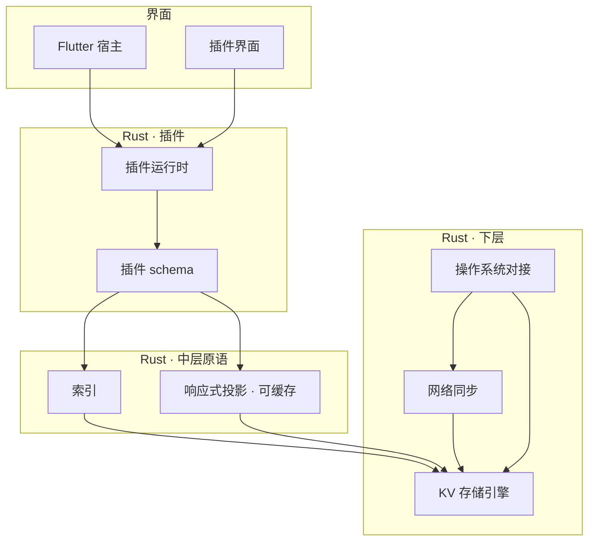

# 002 架构

哲学见 [001 哲学](001-philosophy.md)。这里只定分层和数据怎么走，不定插件的业务字段，也不把某一端的控件库写成已选。

## 沙漏

两头宽，中间窄。

下层很杂：多种存储引擎、操作系统、网络同步。上层也很杂：各种插件的结构和各端界面。中间必须窄，窄到插件和界面都不能直接碰到存储引擎或某一家操作系统的 API。

Todo、Wiki、个人记录都写在 schema 和运行时里，不写进中层。

## 下层：复杂的都放这里

这一层允许按平台分叉，也允许以后换实现。它不出现在插件作者的 API 里。

**存储。** 主库不走 SQLite。要的是 KV：写入路径短，版本和同步按键追加或覆盖，而不是维护一张关系表。引擎可以有多个（本机文件、测试用内存、以后别的介质），对上只暴露同一套读写。旧 Synap 的 core 已经用 KV，这个判断留着；具体用哪一个引擎还没定。

**操作系统对接。** 数据目录、文件导入导出、网络权限、后台保活、密钥存放，这些跟系统走，不跟 Flutter 的控件走。Android 和桌面不会是同一套代码。

**网络同步。** 发现、直连、中继、冲突、加密都在这里。同步搬运的是中层已经提交的版本，不理解「这条是待办还是笔记」。旧仓库里的 relay 和密码学是参考，不是本仓库的定案。

## 中层：原语，保持少

中层是沙漏的腰。它只回答数据库问题：

- 一条记录如何被稳定地标识、写入、按版本读到；
- 如何建索引，而不是全表扫描；
- 如何声明一份**响应式投影**：底层记录变了，投影结果跟着变；投影可以带缓存，避免每次从原始键重算。

投影是中层能力，不是某个插件的界面。缓存是优化，丢了应能重算，不能变成第二份真相。

中层不知道完成、截止、标签、接着说、LLM 分析。这些一旦写进原语，就回到旧 Synap：一种结构开始规定所有用法。

## 上层：插件 schema 与运行时

仍在 Rust 里。

**Schema** 描述一种插件自己的结构：它有哪些记录、哪些索引、哪些投影、哪些动作。Todo 的「完成」和 Wiki 的「当前版本」都是 schema，不是中层类型。

**运行时** 把 schema 接到原语上：校验写入、维护这个插件的索引和投影、在权限内读别的插件公开出来的记录。插件之间只通过运行时约定的引用和查询交互，不读对方的内部表。松耦合指的是这件事。

Agent 也走运行时。它看到的是已经投影好的内容，不是某个聊天 session 里手工贴进去的摘录。

## 再到 Flutter

Rust 运行时之上是 Flutter 宿主。宿主订阅投影、把动作发回运行时，不自己实现一套存储。

界面这条线是从另一条路迁过来的。最早打算 Android 用 Kotlin，Windows 用 C#，Linux 用 GTK，为的是和系统集成得紧。第一方界面时这还能做。现在每个插件都要在每个系统上有界面，每套原生 UI 都要做一份插件渲染，工作量会按平台数乘上去。

Flutter 把这件事收成一套渲染机制：插件描述自己要呈现什么，宿主用 Flutter 画出来，而不是为 Compose、WinUI、GTK 各写一个渲染器。系统集成里真正离不开原生的部分（分享、文件、后台、输入法）仍可以从下层或平台通道接，不要求整页都是系统控件。

这里还没定死：

- Flutter 是否覆盖全部界面，还是个别页面嵌系统控件；
- 插件 UI 是编译进宿主的 Dart 模块，还是运行时下发的描述、由 Flutter 解释。

两种都能用同一条数据通路。在想清楚插件要动态到什么程度之前，不先做多套原生渲染器。

## 一次写入怎么走

1. Flutter 把动作交给插件运行时。
2. 运行时按该插件的 schema 检查，写成中层记录。
3. 中层更新索引，并使相关投影失效或增量更新；缓存跟着变。
4. 下层把新版本交给 KV；同步在之后把版本带到别的设备，而不是在 UI 线程里做。
5. 别的设备上的中层把版本收进 KV，投影再变，Flutter 只看到新的投影结果。

插件的 schema 可以换，投影可以重算。KV 里的版本还在。
