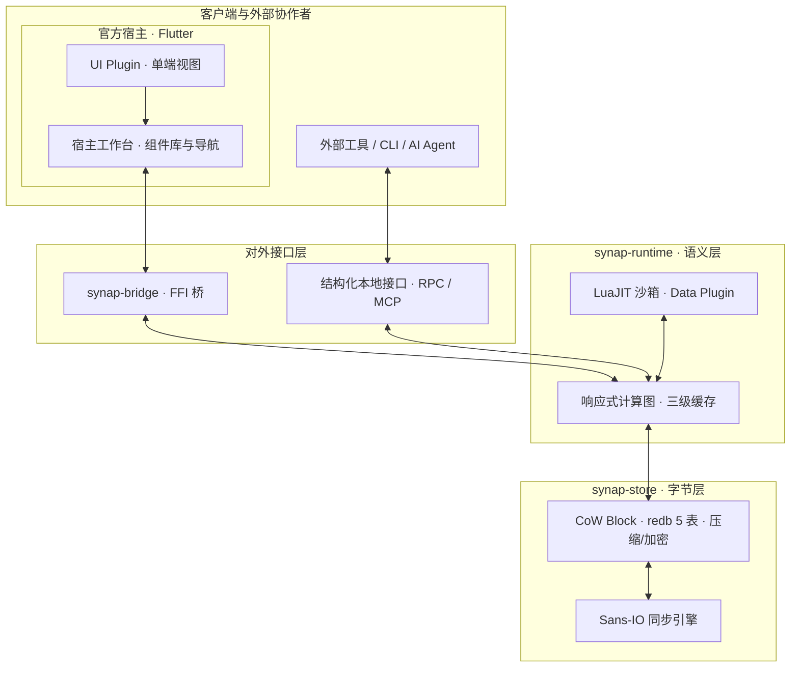

# 002 架构

整体架构是一个**沙漏模型**：两头宽，中间窄。

* **下层宽（重底座）：** 承接操作系统能力、网络传输、嵌入式 KV 存储、加解密压缩管道、Merkle-DAG 同步与响应式增量计算，把最脏最重的系统工程全部消化掉。
* **中间窄（薄契约）：** 对上层收束成极窄的一组核心抽象——**订阅 Projection、读写 Trait、触发 Action**。这不是简单的 CRUD API 转发，而是用概念约束换取上下层的彻底解耦。
* **上层宽（多形态）：** 在这条窄腰之上，长出各种业务结构的 Data Plugin、按端定制的 UI Plugin，以及通过标准接口平等接入的外部工具与 AI Agent。

Rust 侧按职责拆成四个 Crate（`synap-core`、`synap-store`、`synap-runtime`、`synap-bridge`），单向依赖，模块映射见 [004 synap-core](https://www.google.com/search?q=004-synap-core.md)。Todo、Wiki、个人记录全部落在 Data Plugin 和投影里，内核一行业务代码都不写。

---

## 一、Rust 无头内核：存算一体，彻底隔离 UI

Rust 内核保持绝对的 **Headless（无头）**，不依赖任何图形框架，也不内置大模型调用，只负责把字节存稳、把增量算对、把接口暴露干净。它由三个 Crate 组成：

### 1. 共享词汇：`synap-core`

零重度依赖，不碰磁盘、网络和 Lua。集中定义全系统共用的底层原语与数据结构：`Block`、`BlockHash`、`EntityId`、`Hlc`、`LocalSeq`、`Delta` 以及编解码与错误契约。概念定义以 [001 哲学](https://www.google.com/search?q=001-philosophy.md) 为准，三层共用同一套 Rust 类型，杜绝各层自己发明同义词。

### 2. 字节层：`synap-store`

包装 `redb`，对外保持纯同步阻塞接口，专注物理存储与同步原语（详见 [005 store 字节层](https://www.google.com/search?q=005-synap-store.md)）：

* **5 张固定表：** `blocks`（不可变块池）、`local_seq`（本机到达流水）、`entity_heads`（实体多 Head 分叉表）、`projections`（所有常驻投影共用的有序 B-Tree）、`meta`（投影断点与插件归档状态）。无论上层长出多少业务，表结构永不变。
* **透明物理管道：** 压缩（Zstd/LZ4）和加密（ChaCha20/AES）挂在读写路径上，作为原生原语处理；`BlockHash` 始终基于规范化逻辑内容计算，与物理编码解耦。
* **事务原子性：** 常驻投影的 B-Tree 写入与其 `local_seq` 断点更新在同一个 `redb` 事务里提交，保证任意时刻断电重启都不会出现索引与断点错位。
* **Sans-IO 同步：** 只实现 Merkle 差异比对、块集合并集与分批打包的纯状态机，不绑定 `tokio` 或具体网络协议，也完全不理解块里的业务语义。

### 3. 语义层：`synap-runtime`

Rust 负责调度与状态维护，嵌入 LuaJIT（`mlua`）运行插件逻辑（详见 [006 runtime 语义层](https://www.google.com/search?q=006-synap-runtime.md)）：

* **纯函数沙箱：** Data Plugin 源码作为 `schema_hash = 0` 的 Block 加载进沙箱，屏蔽时间、随机数、文件 IO 等非确定性接口，仅注入原生编解码加速函数。
* **四层插件契约：** 将插件职责拆为 `decode`（解码字节）、`resolve`（收敛单实体多 Head 分叉）、`extract`（提取标准 Trait）和 `action`（校验并生成新 Payload）。跨实体约束破坏（如 DAG 成环）由独立校验投影检出并记为 `Conflict`。
* **响应式计算图：** 以 `local_seq` 为心跳驱动计算图。所有算子遵循“吃 Delta、吐 Delta”的闭环，按拓扑深度逐层批处理（消灭菱形依赖闪烁），并在 Trait 输出无变化时触发早停（Early Cutoff）。投影身份由 `名字 + 计算定义哈希` 决定，定义变更自动触发重建。
* **三级缓存生命周期：** 基于可达性（GC Roots = 活跃订阅 + Pinned 常驻索引）管理有状态算子。活跃节点在内存热更新，失去订阅的节点进入休眠池暂存并记下 `local_seq` 断点（短时间切回直接补算差值，超时或内存吃紧按 LRU 回收），常驻索引落盘到 `projections` 表。

---

## 二、对外接口层：FFI 桥与外部平等接入

内核从一开始就面向两类调用方，且两者在权限和能力上完全平等：

* **`synap-bridge`（Flutter FFI 桥）：** 是 Rust 内核通往官方 Flutter 宿主的唯一边界，`flutter_rust_bridge` 的代码生成只扫描这里的公开函数。严禁写业务逻辑，只负责类型翻译、Action 转发，以及把投影增量封装成异步 `Stream` 推给 Dart。
* **外部结构化接口（CLI / 本地服务 / AI Agent）：** 内核向上暴露完整的自省与执行能力——外部调用方可以查询实体历史、读取 Schema 与 Trait 契约、订阅 Projection 变更流，也可以带着完整上下文触发 Data Plugin 的 Action 甚至注册新插件。所有外部写入同样经过沙箱校验与 CoW 不可变块保护，随时可回滚。

---

## 三、插件归属与 Flutter 宿主

两类插件在运行位置和生命周期上彻底分开：

* **Data Plugin 归 Rust 管：** 进块存储、随数据多端同步、只能归档（禁写可读）不能物理删除，保证历史数据永不失效。
* **UI Plugin 归 Flutter 管：** 纯本地存在、不进块存储、随时可删可热换。每个 UI Plugin 只专注适配单一端形态（横屏桌面或竖屏手机），拥有页面的自由布局权，但视觉零件与样式规范统一由宿主组件库锁死（详见 [003 产品形态](https://www.google.com/search?q=003-product-shape.md)）。
* **两边只通过契约见面：** UI Plugin 订阅投影拿数据，通过 Trait 标准接口发动作，不直接耦合具体的 Data Plugin。

### 为什么用 Flutter 做宿主

早期曾考虑 Android 用 Kotlin、Windows 用 C#、Linux 用 GTK 以贴近原生。但在这个架构里，如果每个 UI 插件都要为不同平台重写一套渲染器，维护成本会成倍膨胀。收束到 Flutter 后，全平台共享同一套设计系统与基础组件库，宿主只管“订阅投影、提供规范零件、渲染页面、发回动作”，不自己维护任何存储状态。

### 操作系统对接的边界

真正离不开平台差异的能力——数据目录、文件导入导出（包括未来的本地 Markdown 双向桥接）、后台保活、系统密钥库、分享与输入法——直接跟操作系统走，通过下层或平台通道接入，**不暴露在插件作者的 API 里**。

### 当前故意留白的未定项

在验证完核心闭环和插件动态度需求之前，以下两项不提前写死：

1. Flutter 是覆盖全部页面，还是在极少数重交互场景下嵌入系统原生控件；
2. UI Plugin 是作为 Dart 模块编译进宿主，还是作为运行时下发的声明式描述由 Flutter 动态解释执行。

无论选哪一种，底层走的都是同一条 `Stream + Action` 数据通路，不影响内核设计。

---

## 四、端到端数据流：本地写入与远端同步

本地操作和远端同步在底层走的是**完全一致的响应式路径**：

1. **发起动作：** 用户在 Flutter 界面（或外部工具）触发交互，动作经接口层转发给 `synap-runtime`。
2. **校验与落盘：** `runtime` 调用对应 Data Plugin 的 `action` 校验并生成新 Payload 字节，封装成 `Block`（`parents` 指向当前 `heads`）交给 `synap-store` 走压缩加密管道写入 `blocks`，同时更新 `entity_heads` 并推进本机 `local_seq`。
3. **本地增量传播：** `local_seq` 推进唤醒计算图。引擎对新旧 Head 跑一遍 `resolve` 和 `extract`，算出 `(key, old, -1)` 与 `(key, new, +1)` 的 Delta 按拓扑层推入下游；常驻投影在同一事务里落盘更新，活跃订阅经 `Stream` 实时推送给客户端刷新界面。
4. **后台异步同步：** 独立于 UI 线程的同步器驱动 `synap-store` 的 Sans-IO 状态机，与对端交换 Merkle 差异，拉取或推送缺失的 `Block` 集合。存储层只做集合并集，绝不冲突。
5. **对端自动刷新：** 对端 `store` 收进新块后，同样推进它自己的 `local_seq`。如果产生了多 Head 分叉，`runtime` 把完整分叉列表交给插件的 `resolve`（自动收敛或吐出 `trait.Conflict`），算出的 Delta 顺着计算图推给对端客户端，界面自动同步到最新状态。

整条链路上，数据插件可演进、UI 插件可替换、投影可随时重算，而底层的不可变块历史始终稳如磐石。
