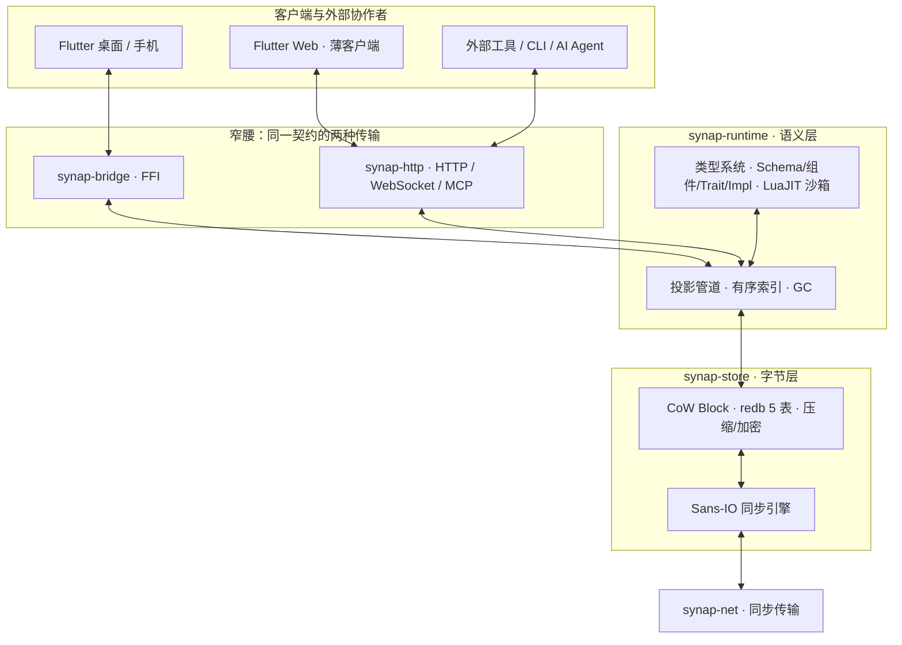

# 002 架构

整体架构是一个**沙漏模型**：两头宽，中间窄。

* **下层宽（重底座）：** 承接操作系统能力、网络传输、嵌入式 KV 存储、加解密压缩管道、Merkle-DAG 同步与响应式增量计算，把最脏最重的系统工程全部消化掉。
* **中间窄（薄契约）：** 对上层收束成极窄的一组核心抽象——**读投影（`get` / `range` / `watch`）、通过 Trait 写入**。这不是简单的 CRUD API 转发，而是用概念约束换取上下层的彻底解耦。这条契约**与传输方式无关**：同一组调用可以走进程内的 FFI，也可以走网络。
* **上层宽（多形态）：** 在这条窄腰之上，长出由组件拼成的各种 Schema、只认 Trait 的视图，以及通过标准接口平等接入的外部工具与 AI Agent。

因为窄腰与传输无关，同一个内核自然有**两种产出**：

| 产出 | 形态 | 用途 |
| --- | --- | --- |
| **Synap 客户端** | Flutter 应用。桌面与手机把内核嵌在本地（FFI）；Web 版是浏览器里的薄客户端，经网络连接节点 | 普通用户的日常使用 |
| **`synap-node`** | 无头节点：一个二进制或 Docker 镜像，提供 CLI、HTTP / MCP、同步，并托管 Web 客户端的静态文件 | 个人服务器、一直在线的同步对端、AI 的接入点，也可以作为自己其他项目的小型数据后端 |

两者是同一套 Rust 代码的两种装配。节点可以先于客户端独立迭代：存储、同步、类型系统与投影都能在没有任何界面时经 CLI 跑通。

Rust 侧的核心是三个无头 Crate（`synap-core`、`synap-store`、`synap-runtime`），单向依赖，模块映射见 [004 synap-core](004-synap-core.md)；外围按接入方式各挂一个薄层：`synap-bridge`（FFI）、`synap-http`（网络接口）、`synap-net`（同步传输）。桌面与手机客户端装配 `synap-bridge` 与 `synap-net`，`synap-node` 装配 `synap-http` 与 `synap-net`，见 [008](008-synap-node.md)。Todo、Wiki、个人记录全部落在数据插件（Schema、组件、Impl）和投影里，内核一行业务代码都不写。

---

## 一、Rust 无头内核：存算一体，彻底隔离 UI

Rust 内核保持绝对的 **Headless（无头）**，不依赖任何图形框架，也不内置大模型调用，只负责把字节存稳、把增量算对、把接口暴露干净。它由三个 Crate 组成：

### 1. 共享词汇：`synap-core`

零重度依赖，不碰磁盘、网络和 Lua。集中定义全系统共用的底层原语与数据结构：`Block`、`BlockHash`、`EntityId`、`Hlc`、`LocalSeq`、`Delta` 以及编解码与错误契约。概念定义以 [001 哲学](001-philosophy.md) 为准，三层共用同一套 Rust 类型，杜绝各层自己发明同义词。

### 2. 字节层：`synap-store`

包装 `redb`，对外保持纯同步阻塞接口，专注物理存储与同步原语（详见 [005 store 字节层](005-synap-store.md)）：

* **5 张固定表：** `blocks`（不可变块池）、`local_seq`（本机到达流水）、`entity_heads`（实体多 Head 分叉表）、`projections`（所有常驻投影共用的有序 B-Tree）、`meta`（投影断点与插件归档状态）。无论上层长出多少业务，表结构永不变。
* **透明物理管道：** 压缩（Zstd/LZ4）和加密（ChaCha20/AES）挂在读写路径上，作为原生原语处理；`BlockHash` 始终基于规范化逻辑内容计算，与物理编码解耦。
* **事务原子性：** 常驻投影的 B-Tree 写入与其 `local_seq` 断点更新在同一个 `redb` 事务里提交，保证任意时刻断电重启都不会出现索引与断点错位。
* **Sans-IO 同步：** 只实现 Merkle 差异比对、块集合并集与分批打包的纯状态机，不绑定 `tokio` 或具体网络协议，也完全不理解块里的业务语义。

### 3. 语义层：`synap-runtime`

Rust 负责类型系统、调度与状态维护，嵌入 LuaJIT（`mlua`）运行插件逻辑（详见 [006 runtime](006-synap-runtime.md)）：

* **纯函数沙箱：** 数据插件源码作为创世约定的 Block（见 004）加载进沙箱，屏蔽时间、随机数、文件 IO 等非确定性接口，仅注入原生编解码加速函数。
* **类型系统原生化：** Schema 由组件组合，解码、按组件委托的合并、Trait 委托都在 Rust 侧完成；Lua 只写组件与 Impl 自己的那点逻辑（`construct`、`extract`、写方法、`upgrade`、可选的自定义 `merge`）。维护一张 `(TraitId, SchemaId) → Impl` 实现表；插件之间的依赖一律锁定大版本，插件升级时全部实体一起迁移，旧版本代码按引用计数回收。
* **冲突分治：** 单实体多 Head 按组件逐字段合并，合并失败才产生精确到字段的 `Conflict`；跨实体约束破坏（如引用成环）由独立校验投影检出。
* **投影管道：** 投影是以 Trait 为源、闭包只看一条记录的算子管道，以 `local_seq` 为心跳、在 Delta 上增量执行（按拓扑深度批处理，输出不变时早停），终点是有序 B-Tree 索引。被监听时增量维护，只问一次时算完即丢；递归不进管道，由读取侧按需驱动。
* **游标式读取与 GC：** 对外只有 `get` / `range` / `watch` 三个读取原语，`range` 以 key 为游标在 MVCC 快照上顺序读，成本与库的大小无关。GC Roots = 活跃 `watch` + 常驻索引；失去监听的管道休眠并记下 `local_seq` 断点，超时或内存吃紧按 LRU 回收；定义变更时后台重建新命名空间，旧的继续服务直到原子切换。

---

## 二、对外接口层：一套契约，两种传输

内核面向的调用方——官方客户端、外部脚本、AI Agent——在权限和能力上完全平等，看到的是同一组入口：打开库、读取原语（`get` / `range` / `watch`）、唯一写入口（Trait 写方法或构造）、实体自省、同步与导入导出。区别只在传输：

* **`synap-bridge`（进程内 FFI）：** 内核嵌在本机进程里时使用。`flutter_rust_bridge` 的代码生成只扫描这里的公开函数；它严禁写业务逻辑，只负责类型翻译与转发，把 `watch` 封装成异步 `Stream` 推给 Dart。
* **`synap-http`（网络）：** 内核运行在节点上时使用。同一组入口映射为 HTTP 请求，`watch` 走 WebSocket；另外提供 MCP 端点：几个通用工具加上自省，供 AI Agent 使用（见 006 §12）。Flutter Web 客户端和外部工具都走这一层。

两层都只是翻译，不各自扩展语义；任何新能力先进契约，再同时出现在两种传输上。外部写入与本地写入一样经过沙箱校验与 CoW 不可变块保护，随时可回滚。

---

## 三、插件归属与 Flutter 宿主

插件只是分发单位。按运行位置分两类，生命周期彻底分开：

* **数据插件归 Rust 管：** 装 Schema、组件、Trait、Impl 与投影定义。进块存储、随数据多端同步、只能归档（禁写可读）不能物理删除，保证历史数据永不失效。
* **视图插件归 Flutter 管：** 装视图。纯本地存在、不进块存储、随时可删可热换。每个视图声明自己的 Trait bound 与适配的端形态（横屏桌面或竖屏手机），拥有页面的自由布局权，但视觉零件与样式规范统一由宿主组件库锁死（详见 [003 产品形态](003-product-shape.md)）。
* **两边只通过 Trait 见面：** 视图用 `range` / `watch` 读投影，通过 Trait 写方法发动作，从不认识具体的 Schema。用户的视图实例（钉住的页面及其参数）作为实体进库同步，视图代码本身不同步。

### 为什么用 Flutter 做宿主

早期曾考虑 Android 用 Kotlin、Windows 用 C#、Linux 用 GTK 以贴近原生。但在这个架构里，如果每个视图都要为不同平台重写一套渲染器，维护成本会成倍膨胀。收束到 Flutter 后，全平台共享同一套设计系统与基础组件库，宿主只管“读取投影、提供规范零件、解析与组合视图、发回动作”，不自己维护任何存储状态；宿主本身是微内核，随手记、待办、情景这些功能都是随包发行的第一方插件（见 003、007）。

### 操作系统对接的边界

真正离不开平台差异的能力——数据目录、文件导入导出（包括未来的本地 Markdown 双向桥接）、后台保活、系统密钥库、分享与输入法——直接跟操作系统走，通过下层或平台通道接入，**不暴露在插件作者的 API 里**。

### 未定项与 v1 的回答

1. Flutter 是覆盖全部页面，还是在极少数重交互场景下嵌入系统原生控件——仍然留白，等真实场景出现再定。
2. 视图是作为 Dart 模块编译进宿主，还是作为运行时下发的声明式描述由 Flutter 动态解释——**v1 编译进宿主、随版本发行**；声明式描述留给下一阶段，届时用于可下载的视图与 AI 生成的视图（见 007）。

无论哪一种，底层走的都是同一条“读投影 + Trait 写入”的数据通路，不影响内核设计。

---

## 四、端到端数据流：本地写入与远端同步

本地操作和远端同步在底层走的是**完全一致的响应式路径**：

1. **发起动作：** 用户在 Flutter 界面（或外部工具）触发交互，动作经接口层转发给 `synap-runtime`。
2. **校验与落盘：** 写入统一表达为 `(EntityId, TraitId, method, args)` 或 `(SchemaId, Construct, args)`。`runtime` 经实现表找到 Impl，在沙箱中执行写方法生成新状态，编码成 Payload，封装成 `Block`（`parents` 指向当前 `heads`）交给 `synap-store` 走压缩加密管道写入 `blocks`，同时更新 `entity_heads` 并推进本机 `local_seq`。
3. **本地增量传播：** `local_seq` 推进唤醒投影管道。引擎对新旧 Head 做合并与 `extract`，算出 `(key, old, -1)` 与 `(key, new, +1)` 的 Delta 流过各管道；索引在同一事务里落盘更新，落入某段被 `watch` 区间的 Delta 合批推送给客户端，只刷新受影响的行。
4. **后台异步同步：** 独立于 UI 线程的同步器驱动 `synap-store` 的 Sans-IO 状态机，与对端交换 Merkle 差异，拉取或推送缺失的 `Block` 集合。存储层只做集合并集，绝不冲突。
5. **对端自动刷新：** 对端 `store` 收进新块后，同样推进它自己的 `local_seq`。如果产生了多 Head 分叉，`runtime` 按组件逐字段合并分叉（合并不了的字段产出 `Conflict`），算出的 Delta 顺着投影管道推给对端客户端，界面自动同步到最新状态。

整条链路上，数据插件可演进、视图可替换、投影可随时重算，而底层的不可变块历史始终稳如磐石。
