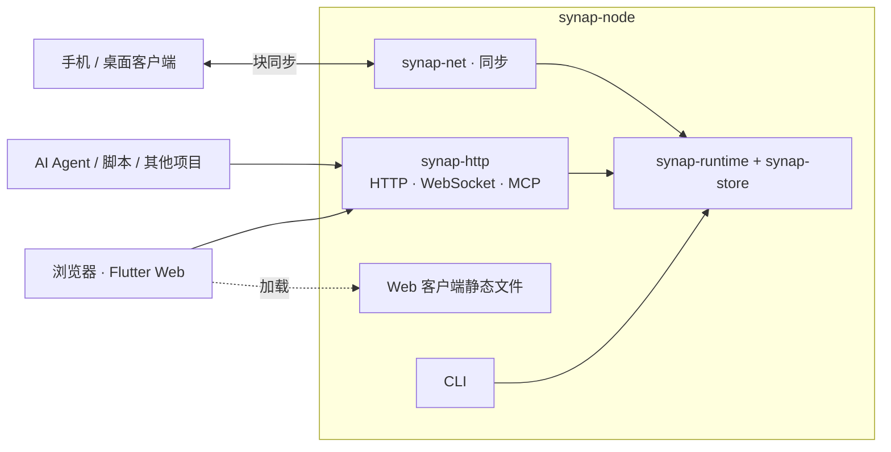

# 008 synap-node：无头节点与外围扩展

`synap-store` 与 `synap-runtime` 都是纯 Rust 的无头库，不依赖任何界面。所以除了嵌进 Flutter 客户端，它们还能单独装配成一个无头节点 `synap-node`，这是项目的第二个产出（见 [002](002-architecture.md)）。本文先讲节点是什么、为什么需要它，再讲组成它的两个外围 Crate。

---

## 一、为什么需要一个节点

只有客户端时，有几件事没有好答案：

* **手机上怎么接 AI：** 手机不适合常驻一个 MCP 服务。
* **iOS 后台同步不可靠：** 两台设备很少同时在线，多端同步需要一个一直在的对端。
* **普通用户不会配同步：** 自建中继、WebDAV 的门槛太高。
* **在没有界面时验证内核：** 存储、同步、类型系统、投影应当先于任何 UI 跑通。

一个一直在线的个人节点同时回答了这四件事。它也是一个合格的小型数据后端：有人为了个人笔记的多端同步，愿意自己部署 CouchDB、配同步插件、再另加一层端到端加密（见 001 “参照”一节）。节点要把这件事做成开箱即用的。

## 二、节点是什么

一个二进制，也发布为 Docker 镜像：

* **CLI：** 建库、装插件、导入导出、查询与写入。插件作者（常常是 AI）可以直接对着 CLI 开发和调试。
* **HTTP / WebSocket / MCP：** 与客户端相同的窄腰契约，加上一组通用 MCP 工具。
* **同步对端：** 手机与桌面在打开时同它交换块，不再需要两台设备同时在线。
* **托管 Web 客户端：** Flutter Web 的构建产物作为静态文件由节点提供，浏览器即客户端。
* **多个库：** 像 CouchDB 的多个数据库一样，一个节点可以承载多个相互隔离的库，各自装各自的插件。个人数据是一个库，自己其他项目的小数据可以是另一个库。

## 三、节点能不能看到明文：可信节点与盲中继

存储是端到端加密的，这让节点有两种互斥的模式：

| | 盲中继 | 可信节点 |
| --- | --- | --- |
| 持有密钥 | 否，只保存加密后的块 | 是 |
| 能做什么 | 作为同步对端参与 Merkle 对账，保存密文 | 运行插件与投影，提供 HTTP / MCP 与 Web 界面 |
| 被攻破时 | 内容不泄露 | 内容泄露 |
| 适合部署在 | 任何地方，包括第三方托管 | 自己控制的机器 |

两者不能混用。带 Web 界面、能被 AI 调用的节点必然是可信节点；一旦它暴露在公网上，HTTPS 与认证就是硬前提。将来若提供官方托管，托管端只做盲中继。同一个二进制按配置选择模式，盲中继模式下不加载任何插件。

### 盲中继：从邮箱到 Merkle 对端

旧 Synap 已经有一个可用的盲中继，采用**邮箱模型**：每台设备以 Ed25519 公钥为地址拥有一个邮箱，发送方把密封信封（sealed envelope）投进对方邮箱，每个“发送方 → 接收方”只保留最新一格；接收方以租约取件、处理完再确认（ack），过期未确认的租约自动释放，长期无人领取的格子按时清理。请求用 Ed25519 签名加时间戳认证，可选再加一层 API Key；状态放在 Redis（可内嵌）里，打包成 Docker 部署。中继自始至终只看到公钥和密文。

新的同步模型让中继可以从“转发消息”升级为“**同步一棵 Merkle 树**”：

* **中继是一个不持有密钥的同步对端。** 它保存的是 `SyncId → 密文帧` 的集合，并在这组 `SyncId` 上自己维护 Merkle Search Tree。这棵树里没有任何秘密——`SyncId` 本身已经是带密钥的不透明哈希——所以中继能参与对账，却不知道任何一块是什么。
* **协议与可信节点完全相同。** 设备与中继、设备与设备、设备与可信节点之间，跑的都是 005 的同一个 Sans-IO 状态机。
* **不再需要租约与确认。** 集合并集是幂等的：块重复推送无害，丢失了下次对账自然补上。邮箱模型里为“恰好送达一次”准备的租约、确认与“最新一格”覆盖语义都可以去掉。
* **存储换成块存储。** 块集合只增不减、持续增长，不适合放在 Redis 里；盲中继直接复用 `synap-store` 的块表与 Merkle 摘要（以 `SyncId` 为键、只存密文帧），只是不加载 `synap-runtime`。

旧中继里仍然值得原样搬过来的部分：

| 搬过来 | 用途 |
| --- | --- |
| Ed25519 请求签名 + 时间戳 + 可选 API Key | 中继端的访问认证，按库或按设备授权 |
| 密封信封 | 设备之间的点对点密封消息 |
| 邮箱（租约 / 确认） | 保留给**一次性消息**：新设备配对时交接库密钥、“有新数据了”的唤醒提示，以及将来不同的人之间分享 |
| 健康检查、状态统计、Docker 部署 | 运维层原样复用 |

邮箱从“同步的全部”退为“同步之外的信令通道”，恰好补上了一个此前没有答案的问题：新设备怎样安全地拿到库密钥。

中继仍然能看到元数据：块的数量、大小、写入时间与来源设备。v1 接受这一点；需要时再以帧填充、批量打包等方式缓解。

## 四、边界：通用，但不做成通用后端平台

“通用”指内核不认识任何 Synap 产品概念——情景、待办都只是插件，所以节点天然能装别的插件、服务别的项目。但它的定位是**个人节点**，以下几件事刻意不做：

* **多用户与权限：** 现在的模型是一个库、一把密钥、一个主人。多人协作需要另一套权限设计，不在当前范围内。
* **SQL 与任意即席查询：** 只有投影管道；临时查询以“只算一次”的管道提交。
* **高并发业务负载：** 每次写入都经过 Lua 沙箱，redb 只有一个写入者。个人与小型项目的数据量绰绰有余，但它不是业务数据库。

窄腰契约是整个项目的核心，节点不为了“通用”而扩展它。

---

## 五、`synap-net`：同步传输

* **职责：** 包装 `synap-store` 的 Sans-IO 同步状态机，引入 `tokio` 和具体传输通道。
* **传输解耦：** 同一套同步状态机可以接入多种后端——局域网直连（mDNS + WebSocket/QUIC）、个人节点或中继、纯静态对象存储（S3 / WebDAV，将块集合打包同步）。
* **运行方式：** 在节点与桌面上作为后台常驻任务；在手机上由宿主按系统保活策略触发增量同步。

## 六、`synap-http`：网络接口与 MCP

* **职责：** 直接依赖 `synap-runtime`，把窄腰契约映射到网络，让外部调用方与官方客户端处于完全平等的地位。它与 `synap-bridge` 一样只做翻译，不扩展语义。
* **两类协议：**
  * **结构化 HTTP / WebSocket 接口：** 与 `SynapBackend` 一一对应（见 007），供 Flutter Web 客户端、CLI 工具、本地脚本、浏览器插件以及未来的 Markdown 文件夹双向桥接器使用。
  * **MCP 端点：** 面向外部 AI Agent。只有几个固定的通用工具（`describe`、`query`、`call`、`construct`、`plugin`、`export` / `import` 等），能力靠 `describe` 自省发现，不随插件增多而膨胀（见 006 §12）。本项目不写大模型代码，只把内核的完整上下文安全地暴露出去：Schema 与 Trait 自省、投影读取、经沙箱与不可变块保护的写入，乃至注册新的数据插件。
